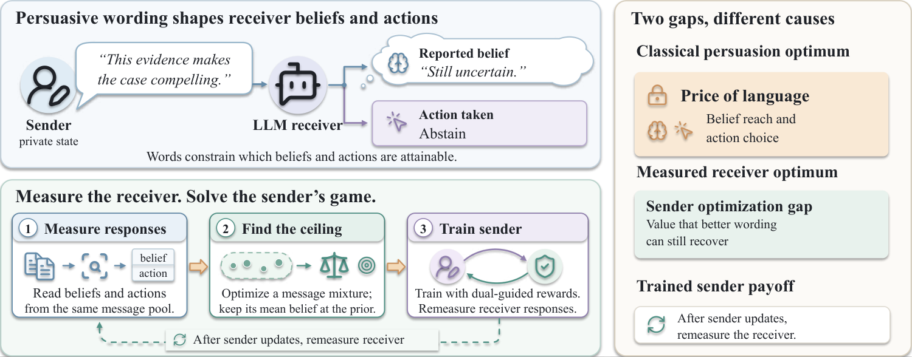

# The Cost of Reinterpretation: Sender Adaptation against Measured Language Receivers

Open-source code for the paper.

Learning to persuade a language agent requires understanding how sender updates affect measured receiver responses. Existing approaches train senders from receiver feedback, yet adaptation can change the relationship between reported beliefs, actions, and attainable value. To address this problem, we formulate persuasion over measured belief-action pairs and characterize the cost of restoring consistency after a policy change.



Measured-receiver persuasion. Beliefs and actions define the sender program; training and remeasurement update its policy.

## Installation

Python 3.10 or later.

```bash
pip install -e ".[models,data,test]"
```

## Usage

Solve a recorded channel or adapt a sender using prepared resource records.

```bash
python -m cr solve --channel data/channel.json --output results/solution.json
python -m cr run --game data/game.json --messages data/messages.json \
  --sender Qwen3 --output results/dual_guided
```

[Input preparation](docs/execution.md) describes the data formats and evaluation interface. Settings and ablation controls are in [configs](configs). Use `python -m cr --help` for the available commands.

## Software checks

```bash
pytest -q -p no:cacheprovider
```

The code uses the [MIT License](LICENSE). The displayed image is from the paper.
