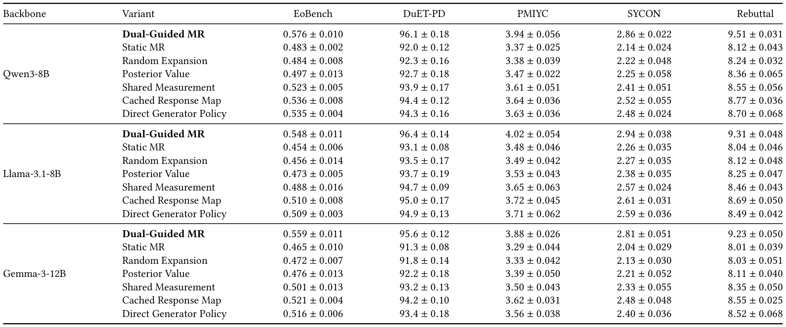
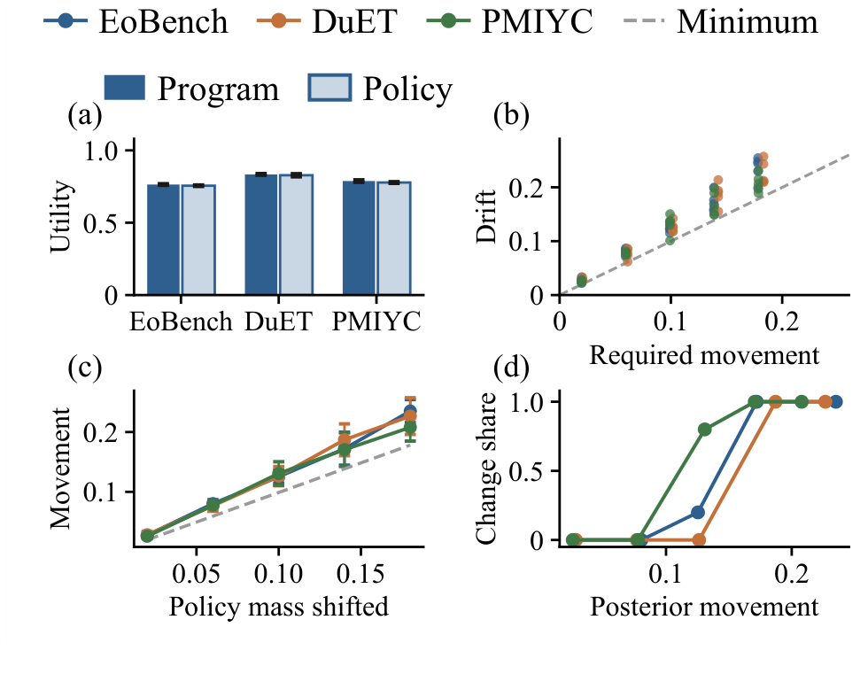

# The Cost of Reinterpretation: Sender Adaptation against Measured Language Receivers

Learning to persuade a language agent requires understanding how sender updates
affect measured receiver responses. Existing approaches train senders from
receiver feedback, yet adaptation can change the relationship between reported
beliefs, actions, and attainable value. To address this problem, we formulate
persuasion over measured belief-action pairs and characterize the cost of
restoring consistency after a policy change. We derive the exact minimum
posterior movement and, for binary states, a necessary and sufficient condition
for preserving receiver actions during this adjustment. Specifically, a finite
linear program computes the optimal sender value compatible with the measured
channel and reconstructs an implementing policy. Its dual prices guide
reinforcement learning of new messages, while a consistency residual guides
receiver remeasurement. We evaluate the framework on five public benchmarks with
Qwen3, Llama3, and Gemma3 sender backbones. Dual-guided learning achieves the
highest response scores of the four compared procedures across all fifteen
benchmark-backbone combinations. Controlled policy shifts demonstrate how
consistency requirements, receiver information, and action changes interact.
Residual-triggered refresh retains 98 percent of continual-refresh sender value
using 31 percent of its remeasurement queries. These results connect receiver
measurement, sender learning, and adaptation.

## Algorithm Flow

To optimize communication while maintaining a current receiver model, we combine exact finite-pool optimization with message acquisition.

1. Measure posteriors and action responses on the initial pool. Expand the pool until feasible or the budget ends.
2. If the measured pool is feasible, solve the primal and dual programs and update the generator using the dual-guided objective in each acquisition round while queries remain.
3. Generate and independently confirm candidates. Add candidates whose confirmed reduced cost exceeds the admission threshold.
4. Compute the marginal from the proposed policy. If the L1 norm of its posterior-consistency residual exceeds the refresh threshold or the receiver checkpoint changes, refresh measurements and resolve the program.
5. Independently measure the final pool and solve for the message marginal.
6. Return the reconstructed policy if the final measured pool is feasible; otherwise return additional measurement required.


**Figure 1.** Measured-receiver persuasion. Beliefs and actions define the sender program; training and remeasurement update its policy. The illustrated channel has a positive classical-to-measured gap, distinct from the sender optimization gap.

## Results

### Main Results

**Table 1.** Main results on five public benchmarks, with mean and standard deviation over five seeds. Columns report EoBench context following, DuET-PD misleading-persuasion flips (percent), PMIYC raw final agreement (five-point scale), SYCON stance flips (five turns), and Rebuttal-RM scores (ten-point scale). Optimized senders share interaction budgets.


### Ablation Study

**Table 2.** Component ablations across three sender backbones under shared interaction budgets. Values are mean and standard deviation over five seeds, with the metrics of Table 1. Each variant changes the component defined in the text.



### Analysis



**Figure 2.** Theory and empirical behavior. (a) Predicted and realized utility. (b) Observed movement against the consistency-restoration minimum. (c) Movement as policy mass shifts. (d) Share of runs with action changes.

## Getting Started

### Environment Setup

Use Python 3.10 or later and install PyTorch for your system.

```bash
python -m venv .venv
source .venv/bin/activate
python -m pip install -e '.[models,data]' \
  --index-url https://pypi.tuna.tsinghua.edu.cn/simple
export HF_ENDPOINT=https://hf-mirror.com
```

### Data Preparation

Download the benchmark sources:

```bash
python -m cr fetch --output external
```

Map the downloaded record fields in `data/schema.yaml`, using the
[record format](docs/execution.md#resource-records). Prepare the messages and game:

```bash
python -m cr prepare --records data/released.jsonl --schema data/schema.yaml \
  --resource EoBench --output data/prepared
```

### Training and Evaluation

Set the sender and receiver models in `configs/paper.yaml`.
Run sender training with dual-guided rewards:

```bash
python -m cr run --game data/prepared/game.json \
  --messages data/prepared/messages.json --sender Qwen3 \
  --method dual_guided --output results/dual_guided
```

Set the official benchmark evaluator in `data/evaluator.yaml`, then evaluate
the learned policy:

```bash
python -m cr native-evaluate --game data/prepared/game.json \
  --records data/evaluation.jsonl --evaluator data/evaluator.yaml \
  --policy results/dual_guided/group_policies.json --output results/native.json
```

The [evaluation guide](docs/execution.md#native-evaluation) covers evaluator setup,
single-context policies, and result aggregation.

## License

[MIT License](LICENSE).
