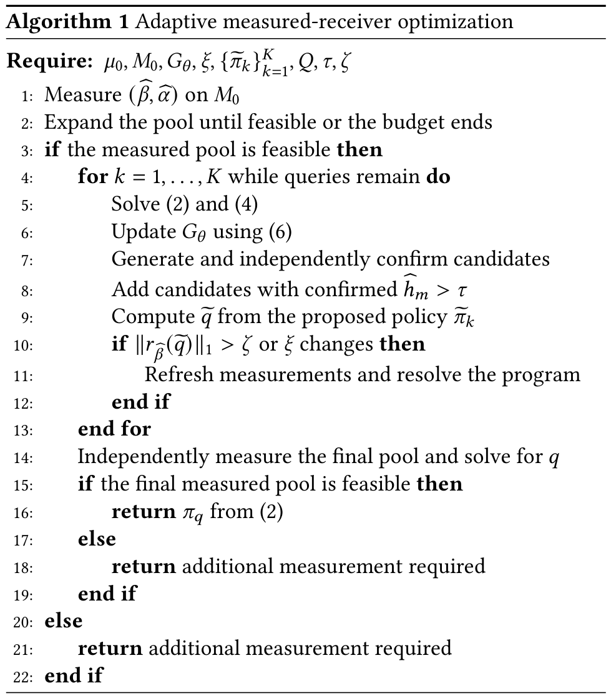
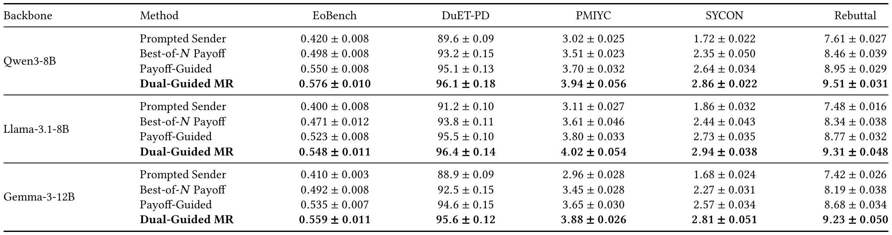

# The Cost of Reinterpretation: Sender Adaptation against Measured Language Receivers

Learning to persuade a language agent requires understanding how sender updates
affect measured receiver responses. Existing approaches train senders from
receiver feedback, yet adaptation can change the relationship between reported
beliefs, actions, and attainable value. To address this problem, we formulate
persuasion over measured belief-action pairs and characterize the cost of
restoring consistency after a policy change. We derive the exact minimum
posterior movement and, for binary states, a necessary and sufficient condition
for preserving receiver actions during this adjustment. Specifically, a finite
linear program computes the optimal sender value compatible with the measured
channel and reconstructs an implementing policy. Its dual prices guide
reinforcement learning of new messages, while a consistency residual guides
receiver remeasurement. We evaluate the framework on five public benchmarks with
Qwen3, Llama3, and Gemma3 sender backbones. Dual-guided learning achieves the
highest response scores of the four compared procedures across all fifteen
benchmark-backbone combinations. Controlled policy shifts demonstrate how
consistency requirements, receiver information, and action changes interact.
Residual-triggered refresh retains 98 percent of continual-refresh sender value
using 31 percent of its remeasurement queries. These results connect receiver
measurement, sender learning, and adaptation.

## Algorithm Flow


**Figure 1.** Measured-receiver persuasion. Beliefs and actions define the sender program; training and remeasurement update its policy. The illustrated channel has a positive classical-to-measured gap, distinct from the sender optimization gap.



To optimize communication while maintaining a current receiver model, we combine exact finite-pool optimization with message acquisition. First, a compatible sender program defines the acquisition objective. Next, its dual prices guide generator training. Finally, the consistency analysis quantifies the adjustment associated with a proposed policy change and motivates receiver remeasurement.

1. **Measured sender optimization.** Measuring both quantities allows the sender objective to reflect the receiver’s observed decisions. Bayes plausibility identifies the message mixtures that admit a compatible signaling policy, yielding an exact finite linear program. The program separates the value available within the measured pool from the value attained by a particular sender.

2. **Dual-guided policy learning.** Its dual prices then guide policy-gradient training toward messages that improve the jointly feasible mixture. The reduced cost evaluates payoff together with the value of the posterior mass needed to support it. Independent receiver samples confirm candidates before admission, after which the expanded program updates the mixture and dual prices.

3. **Receiver remeasurement and deployment.** The cached residual measures consistency pressure before remeasurement; the residual difference gives a lower bound on observed drift after remeasurement. Monitoring the proposed marginal therefore precedes receiver refresh and final reconstruction. Independent final measurements supply the deployed policy. Finally, reconstructing the policy from its optimal mixture connects the acquisition objective to execution.

## Results

### Main Results

**Table 1.** Main results on five public benchmarks, with mean and standard deviation over five seeds. Columns report EoBench context following, DuET-PD misleading-persuasion flips (percent), PMIYC raw final agreement (five-point scale), SYCON stance flips (five turns), and Rebuttal-RM scores (ten-point scale). Optimized senders share interaction budgets.



**Dual-guided acquisition increases receiver-response scores across all fifteen combinations.** On Qwen3, its scores exceed Payoff-Guided by 0.026 on EoBench, 1.0 percentage point on DuET-PD, 0.24 on PMIYC, 0.22 stance flips on SYCON, and 0.56 on Rebuttal. The dual score favors candidates that improve the compatible mixture, connecting acquisition to the final information structure. The matched training configuration identifies the objective as the principal intervention, supporting the use of consistency prices in acquisition.

**Training provides gains beyond payoff-ranked sampling.** For Qwen3, Best-of-N Payoff reaches 0.498 on EoBench and 2.35 on SYCON, against 0.550 and 2.64 for Payoff-Guided and 0.576 and 2.86 for Dual-Guided MR, and Rebuttal runs the same progression from 8.46 to 8.95 and 9.51. Sampling finds useful existing candidates, training moves the proposal distribution, and dual guidance prices their contribution to the jointly feasible mixture.

## Getting Started

### Environment Setup

```bash
conda create -n cr python=3.10 -y
conda activate cr
pip install -e '.[models,data]'
```

### Data Preparation

Download the benchmark sources:

```bash
python -m cr fetch --output external
```

Map the downloaded record fields in `data/schema.yaml`, using the
[record format](docs/execution.md#resource-records). Select the resource and its native evaluator:

| Resource | Evaluator |
| --- | --- |
| EoBench | `configs/native/eobench.yaml` |
| DuET-PD | `configs/native/duet-pd.yaml` |
| PMIYC | `configs/native/pmiyc.yaml` |
| SYCON-Bench | `configs/native/sycon-bench.yaml` |
| RebuttalBench | `configs/native/rebuttalbench.yaml` |

Prepare the messages and game for the selected resource:

```bash
RESOURCE=EoBench
EVALUATOR=configs/native/eobench.yaml

python -m cr prepare --records data/released.jsonl --schema data/schema.yaml \
  --resource "$RESOURCE" --output data/prepared
```

## Training

The sender profiles in `configs/paper.yaml` use
[Qwen3-8B](https://huggingface.co/Qwen/Qwen3-8B),
[Llama-3.1-8B-Instruct](https://huggingface.co/meta-llama/Llama-3.1-8B-Instruct), and
[Gemma-3-12B-it](https://huggingface.co/google/gemma-3-12b-it).
Choose `SENDER=Qwen3`, `SENDER=Llama3`, or `SENDER=Gemma3`.
The primary receiver is Llama-3.1-8B-Instruct. Run sender training with dual-guided rewards:

```bash
SENDER=Qwen3

python -m cr run --game data/prepared/game.json \
  --messages data/prepared/messages.json --sender "$SENDER" \
  --method dual_guided --output results/"$RESOURCE"/"$SENDER"/dual_guided
```

## Evaluation

Set the endpoint, model and prepared schema path in the selected evaluator,
then evaluate the learned policy with the benchmark's native protocol:

```bash
python -m cr native-evaluate --game data/prepared/game.json \
  --records data/evaluation.jsonl --evaluator "$EVALUATOR" \
  --policy results/"$RESOURCE"/"$SENDER"/dual_guided/group_policies.json \
  --output results/"$RESOURCE"/"$SENDER"/native.jsonl
```

Add `--resume` to continue a saved evaluation with the same inputs.
The [evaluation guide](docs/execution.md#native-evaluation) covers evaluator setup
and result aggregation.

## License

[MIT License](LICENSE).
