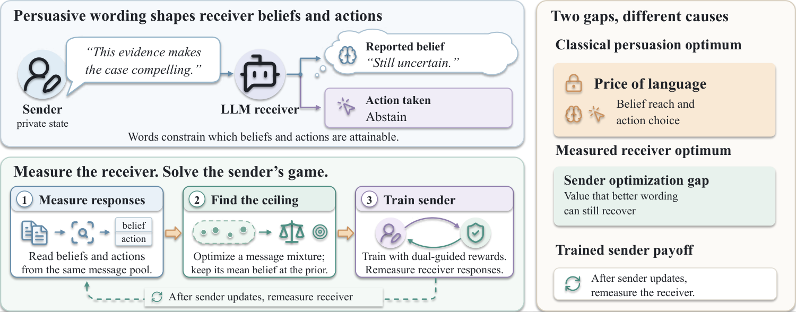

# The Cost of Reinterpretation: Sender Adaptation against Measured Language Receivers

Learning to persuade a language agent requires understanding how sender updates
affect measured receiver responses. Existing approaches train senders from
receiver feedback, yet adaptation can change the relationship between reported
beliefs, actions, and attainable value. To address this problem, we formulate
persuasion over measured belief-action pairs and characterize the cost of
restoring consistency after a policy change. We derive the exact minimum
posterior movement and, for binary states, a necessary and sufficient condition
for preserving receiver actions during this adjustment. Specifically, a finite
linear program computes the optimal sender value compatible with the measured
channel and reconstructs an implementing policy. Its dual prices guide
reinforcement learning of new messages, while a consistency residual guides
receiver remeasurement. We evaluate the framework on five public benchmarks with
Qwen3, Llama3, and Gemma3 sender backbones. Dual-guided learning achieves the
highest response scores of the four compared procedures across all fifteen
benchmark-backbone combinations. Controlled policy shifts demonstrate how
consistency requirements, receiver information, and action changes interact.
Residual-triggered refresh retains 98 percent of continual-refresh sender value
using 31 percent of its remeasurement queries. These results connect receiver
measurement, sender learning, and adaptation.



## Installation

Use Python 3.10 or later and install PyTorch for your system.

```bash
python -m venv .venv
source .venv/bin/activate
python -m pip install -e '.[models,data]' \
  --index-url https://pypi.tuna.tsinghua.edu.cn/simple
export HF_ENDPOINT=https://hf-mirror.com
```

## Data preparation

Download the benchmark sources:

```bash
python -m cr fetch --output external
```

Follow the [data guide](docs/execution.md#resource-records) to create a schema for
the downloaded records, then prepare the messages and game:

```bash
python -m cr prepare --records data/released.jsonl --schema data/schema.yaml \
  --resource EoBench --output data/prepared
```

## Training

Choose the sender and receiver models in [configs/paper.yaml](configs/paper.yaml).
Run sender training with dual-guided rewards:

```bash
python -m cr run --game data/prepared/game.json \
  --messages data/prepared/messages.json --sender Qwen3 \
  --method dual_guided --output results/dual_guided
```

To measure a message pool and solve its sender problem separately, use the
`measure` and `solve` commands described in the [execution guide](docs/execution.md).

## Evaluation

Configure the evaluator for your benchmark using
[configs/native/](configs/native), then evaluate the learned policy:

```bash
python -m cr native-evaluate --game data/prepared/game.json \
  --records data/evaluation.jsonl --evaluator data/evaluator.yaml \
  --policy results/dual_guided/group_policies.json --output results/native.json
```

The [evaluation guide](docs/execution.md#native-evaluation) covers evaluator setup,
single-context policies, and result aggregation.

## License

[MIT License](LICENSE).
